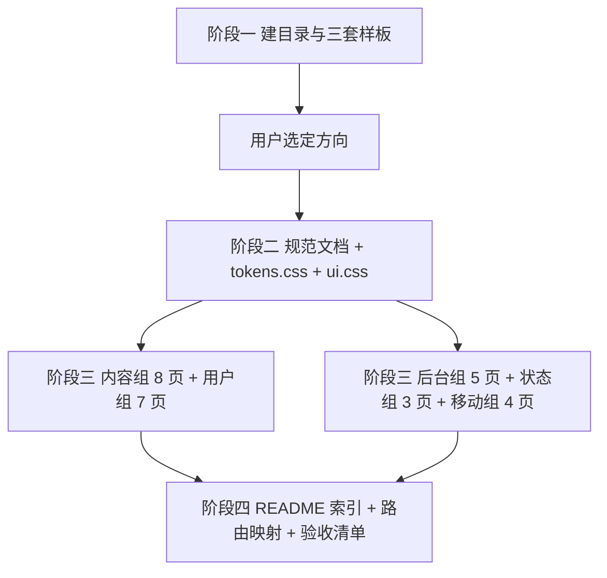

## 用户需求

用户明确要求**从零新建一套 UI 设计体系**，不是改造现有站点：

- 输出新的设计规范：组件、样式、布局、字体、配色、效果
- 输出**每个页面**的原型设计图（HTML）
- 新建目录 **V2**，输出对应文档
- **严禁参考原网站设计**（用户认为原站设计丑，此前在旧结构上打补丁的做法已被否定）
- 本轮不修改 `web/` 下任何代码，只产出设计物

## 产品概述

为一套以文字为主的校园社区（话题、文章、公告、作业、答疑、奖惩、热榜）建立全新视觉语言。三套候选方向风格迥异，用户选定一套后展开全站，最终形成可交付给前端实现的设计源文件：统一 token、统一组件规格、每页可直接打开的 HTML 原型。

## 核心功能

**阶段一：三套方向样板（本轮交付）**

- 方向 A · 瑞士网格：纯白底、墨黑字、单一橙红强调、十二栏硬网格、零圆角、超大字重对比、印刷海报气质
- 方向 B · 深墨夜读：近黑棕底、米白字、金铜强调、衬线标题配等宽数字、2px 微圆角、细金线分层、学术期刊气质
- 方向 C · 高对比杂志：米白底、近黑字、砖红强调、超粗 48–64px 标题、3px 黑色横线分隔、报纸头版气质

每套样板均为完整首页，含顶栏、分类筛选条、至少 5 条内容列表、右侧栏、分页、页脚，并有按钮三尺寸、标签、输入框、类型标识、空态小样。

**阶段二至四：全站 24 页**

- 内容组 8 页：首页列表、话题详情、发布页、文章列表、文章详情、分类页、标签页、搜索结果
- 用户组 7 页：个人主页、登录、注册、账号设置、我的收藏、积分明细、消息中心
- 后台组 5 页：数据看板、内容管理表格、用户管理、审核队列、系统设置
- 状态组 3 页：空态合集、错误页（404/500/403）、骨架屏
- 移动组 4 页：移动首页、移动详情、移动发布、底部导航

## 验收标准

三套样板在 1440 与 375 两档宽度下均无横向滚动、无文字溢出；同一批内容在三套中呈现的**布局节奏明显不同**（不只是换色）；每套内部字号、间距、颜色自成体系；所有 HTML 双击即可在浏览器打开。

## 技术栈

- 原型载体：纯 HTML + CSS（CSS 内联于 `<style>`），仅用少量原生 JS 处理标签切换与展开收起
- 无构建、无 npm、无外链依赖，双击即开
- 字体：优先系统字体栈（`-apple-system` / `PingFang SC` / `Microsoft YaHei` / `Georgia` / `Consolas`），不依赖网络字体，保证离线可用
- 图标：内联 SVG，不使用图标字体或 emoji
- 截图验证：使用 `playwright-cli` 在 1440 与 375 两档宽度下截图核查

## 实现策略

**1. 三套互不污染**

三套方向不共享样式表，各自独立单文件，类名统一加前缀 `a-` / `b-` / `c-`，避免用户复制粘贴后冲突。

**2. 同一内容、三种组织方式**

三套样板必须使用同一批假数据（同类目、同作者、同时间戳、同统计数），仅改变设计语言。这样用户能直接对比「同一内容在三种体系下的阅读体验」，而不是对比三份不同文案。

组织方式必须真正不同：

- 方向 A：列表项为三栏网格（左侧序号 + 中间标题摘要 + 右侧元信息列），靠 1px 硬线与大留白分区
- 方向 B：列表项为时间轴式单列，左侧时间戳等宽数字 + 竖细线，右侧标题与摘要，靠明度分层
- 方向 C：列表项为头版式，首条占双栏高度、超大标题，其余条目紧凑两栏，靠 3px 粗黑线切分版块

**3. Token 在样板内先落地，选定后再抽公共文件**

阶段一每套在自己的 `<style>` 顶部用 `:root` 定义完整 token（颜色、字号、间距、圆角、线宽、动效时长）。用户选定后，阶段二把选中那套的 token 原样抽到 `assets/tokens.css`，不重新设计。

**4. 阶段划分的依据**

方向未定就做 24 页，一旦用户改选意味着全部重做。因此先交 3 页样板作为决策依据，再按选定方向批量展开，避免返工。

## 实现要点

- **自包含**：每个 HTML 内联全部 CSS 与 SVG，不引用任何外部文件，避免相对路径失效
- **无横向滚动**：所有网格使用 `minmax(0, 1fr)`，长标题 `overflow-wrap: anywhere`，图片位用固定比例占位块
- **可访问性**：正文对比度 ≥ 4.5:1；方向 B 深色底上不使用低于 #8A8377 的灰；所有可点击元素有 `:focus-visible` 描边
- **动效克制**：仅两处——列表项入场淡入、hover 变色；统一 `prefers-reduced-motion` 降级
- **不做的事**：不引入 Tailwind、不引入组件库、不写业务逻辑、不碰 `web/` 任何文件

## 架构设计



## 目录结构

```
docs/V2/
├── README.md                          [NEW] 总览：三方向对比表、如何查看、页面清单、阶段规划
├── showcase/                          [NEW] 阶段一产物
│   ├── a-swiss-grid.html              [NEW] 方向 A 瑞士网格首页，自包含，类名前缀 a-
│   ├── b-ink-night.html               [NEW] 方向 B 深墨夜读首页，自包含，类名前缀 b-
│   └── c-poster-magazine.html         [NEW] 方向 C 高对比杂志首页，自包含，类名前缀 c-
├── spec/                              [NEW 阶段二] 选定方向后产出五份文档
│   ├── 01-tokens.md                   [NEW] 颜色/字号/间距/圆角/线宽/阴影/动效时长全表
│   ├── 02-typography.md               [NEW] 字体族、字号阶、字重、行高、字距、中文排版细则
│   ├── 03-layout.md                   [NEW] 网格列数、容器宽度、断点、页面骨架、留白节奏
│   ├── 04-components.md               [NEW] 按钮/输入/标签/卡片/列表/表格/分页/空态/浮层规格
│   └── 05-motion-effects.md           [NEW] 动效清单、时长曲线、hover/focus 状态、降级规则
├── assets/                            [NEW 阶段二]
│   ├── tokens.css                     [NEW] 从选定样板抽取的 token，唯一来源
│   └── ui.css                         [NEW] 组件样式，页面原型统一引用
├── pages/                             [NEW 阶段三] 全站 23 页（不含移动）
│   ├── content/                       [NEW] 首页列表/话题详情/发布/文章列表/文章详情/分类/标签/搜索 共 8 页
│   ├── user/                          [NEW] 个人主页/登录/注册/设置/收藏/积分/消息 共 7 页
│   ├── admin/                         [NEW] 看板/内容管理/用户管理/审核队列/系统设置 共 5 页
│   └── states/                        [NEW] 空态合集/错误页/骨架屏 共 3 页
└── mobile/                            [NEW 阶段四] 移动首页/详情/发布/底部导航 共 4 页
```

## 阶段一交付判定

- 三个 HTML 均可直接双击打开，无任何 404 资源
- 三套在同一批假数据下呈现的布局结构可见地不同
- 每套在 1440 / 375 两档宽度截图无横向滚动、无文字截断

## 设计任务

为文字型校园社区建立三套互斥的视觉语言，供用户选定一套后展开全站 24 页。三套必须在气质上拉开距离，不能是同一套换色。

## 方向 A · 瑞士网格（a-swiss-grid.html）

**定位**：国际主义平面设计，把社区列表做成印刷品目录。

- 底色纯白 `#FFFFFF`，正文 `#111111`，次要文字 `#6B6B6B`
- 唯一强调色橙红 `#FF3B00`，只用于主按钮、当前导航下划线、序号、hover，全页不超过 6 处
- 字体：`Helvetica Neue` / `Inter` 无衬线；标题 40–56px、字重 700、字距 `-0.02em`；正文 16px/1.7
- 零圆角、零阴影。分隔只用 1px `#E3E3E3` 硬线
- 布局：12 栏网格，容器 1200，栏距 24；列表项为「序号 60px + 内容 1fr + 元信息 240px」三栏
- 顶栏：64 高，logo 左、导航居中、搜索与头像右，底部一条 1px 硬线
- 气质关键词：秩序、留白、硬边、克制

## 方向 B · 深墨夜读（b-ink-night.html）

**定位**：夜间长文阅读，学术期刊与藏书票的融合。

- 底色 `#14120F`，卡片 `#1C1916`，正文 `#E8E2D5`，次要 `#8A8377`
- 强调色金铜 `#C9A227`，用于标题装饰线、当前导航、级别标识；不使用纯白
- 字体：标题 `Noto Serif SC` / `Georgia` 衬线；数字用 `JetBrains Mono` / `Consolas` 等宽；正文 15px/1.85
- 圆角 2px，阴影只给浮层，卡片之间靠明度差与 1px `#2E2A24` 细线分层
- 布局：单栏 760 居中 + 右侧 280 窄栏；列表项为「时间戳 88px 等宽 + 竖细线 + 内容」时间轴式
- 顶栏：56 高、半透明深底 + 1px 底边，logo 衬线体带字距
- 气质关键词：沉静、书卷、低照度、耐读

## 方向 C · 高对比杂志（c-poster-magazine.html）

**定位**：报纸头版，冲击力优先，标题即主角。

- 底色米白 `#F5F0E8`，正文近黑 `#0A0A0A`，次要 `#5C5347`
- 强调色砖红 `#B3202E`，用于栏目标签、主按钮、首条序号
- 字体：标题 `Oswald` / `Impact` 极粗无衬线，48–64px、字重 800、行高 1.05；正文 15px/1.75
- 零圆角、零阴影；版块之间用 3px 纯黑横线切分，栏目标签为黑底白字小方块
- 布局：容器 1240，首条内容占 2/3 宽度并配超大标题，其余条目两栏紧凑排列；右侧栏为「热榜 + 公告」窄条
- 顶栏：72 高，中央为超大 logo，导航在其下方一行，栏目之间用竖线分隔
- 气质关键词：浓烈、版式感、新闻性、强对比

## 统一的信息架构（三套共用）

顶栏 → 分类筛选条 → 主体两栏（内容列表 + 右侧栏）→ 分页 → 页脚。
右侧栏固定三块：站点概况（帖数/用户数/今日新增）、活跃用户（5 个头像位）、最新公告（2 条）。

## 列表项必含信息

标题、两行摘要、作者、发布时间、浏览数、评论数、内容类型标识（话题/动态/问答/文章）。
三套用各自的设计语言表达「类型」，不使用同一套彩色徽标：

- A：类型以等宽大写小字 + 下划线呈现，靠文字不靠颜色
- B：类型以衬线小字 + 金色细竖线呈现
- C：类型以黑底白字方块标签呈现

## 交互与效果

- 列表项 hover：A 为序号变橙红，B 为左侧竖线变金铜，C 为标题下划粗线
- 按钮三尺寸：主按钮、常规按钮、文字按钮，三套各自定义高度与内边距
- 空态小样：每套页面底部展示一个「暂无内容」区块，验证空态在各自体系下的处理
- 动效：仅入场淡入 180ms 与 hover 变色 120ms，`prefers-reduced-motion` 下全部关闭
- 响应式：≥1200 两栏；768–1199 右侧栏下沉；<768 单栏、顶栏折叠为汉堡位、列表项元信息并入第二行

## Agent Extensions

### Skill

- **frontend-design**
- Purpose: 三套首页样板是最容易滑向通用模板的环节，用该技能约束创作方向，确保三套在字体、网格、节奏、留白上真正拉开差距，而不是同一套换色
- Expected outcome: 三份可双击打开的自包含 HTML，1440 与 375 两档均无横向滚动，三套布局结构肉眼可分

- **playwright-cli**
- Purpose: 对三套样板在 1440 与 375 两档宽度截图，客观核查横向滚动、文字溢出、对比度问题
- Expected outcome: 六张截图回看确认，发现的问题当场修正后再交付

### SubAgent

- **code-explorer**
- Purpose: 阶段三批量产出 24 页时，用于核查已产出页面之间的 token 使用一致性（是否存在游离色值、字号越档），不用于参考原站代码
- Expected outcome: 输出越档清单，修正后再进入验收