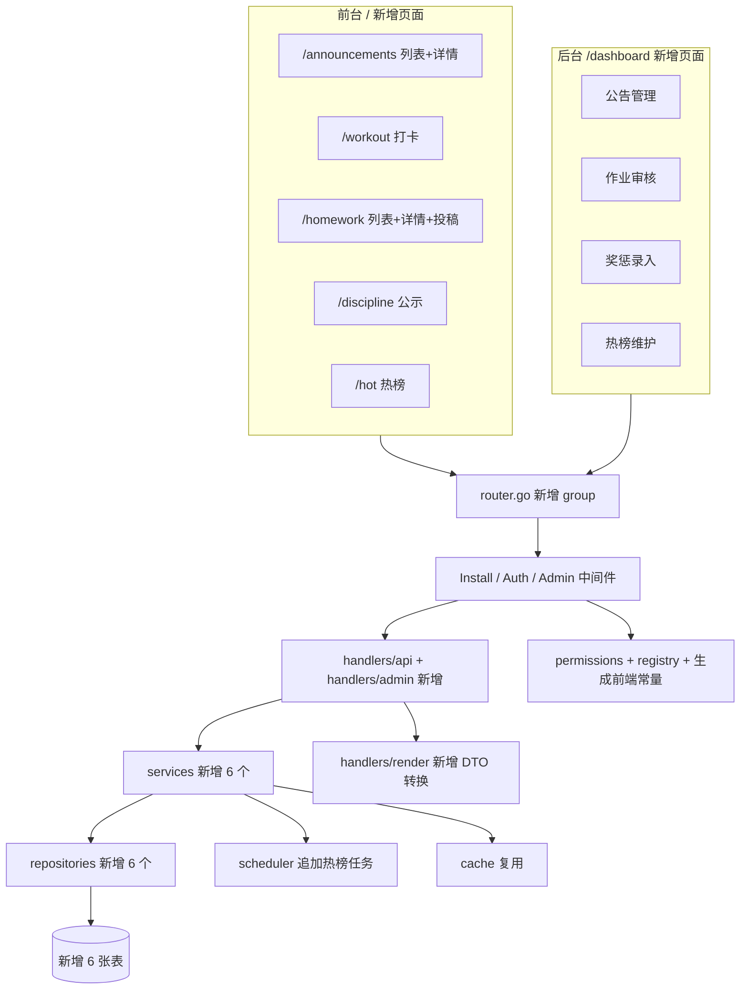

## 产品概述

在现有 bbs-go 社区的基础上，**只做增量扩展**，不修改任何既有业务逻辑（不改 `t_topic`、`t_article`、`t_user`、`t_category`、`t_comment` 等表结构与语义，不改既有接口的路径、入参与返回结构，不改既有页面行为），新增 6 个模块并接入前台导航与后台管理。

## 核心功能

### 1. 公告通知

管理员在后台发布公告（标题、正文、级别：普通/重要/紧急、置顶、有效期起止、状态：草稿/发布/下线）。前台提供独立列表页与详情页，仅展示已发布且在有效期内的公告；置顶公告排在列表最前，详情页记录浏览量。用户查询方式为「列表 + 详情」，不弹窗、不推站内信。

### 2. 运动健身（打卡）

登录用户每日打卡一次，记录运动类型、时长、距离、备注、配图。页面展示：今日打卡状态、当前连续天数、历史最长连续天数、累计打卡天数与总时长、近 30 天打卡日历。同一用户同一天重复提交视为更新当日记录。

### 3. 优选作业（用户投稿 + 评选）

登录用户提交作业（标题、科目、年级、图文内容、附件），提交后进入「待评选」。管理员在后台审核：通过（进入优选展示）、驳回（附驳回理由）。前台列表只展示已通过的作品，支持按科目筛选、按时间或热度排序；详情页展示大图与作者信息。普通用户看不到待评选和已驳回的内容。

### 4. 答疑解惑

不新建数据结构，直接复用现有问答能力：新建一个 `type=qa` 的分类节点，获得未解决/已解决筛选、悬赏、采纳答案、问答状态标记全套能力。前台从「社区」下拉进入该分类。

### 5. 奖罚惩戒（公示）

管理员录入奖惩记录（关联用户、类型：奖励/惩罚、类别如「助人为乐」「违规灌水」、展示分值、事由、执行人、公示时间）。前台提供公示列表，奖励与惩罚用不同色系区分。**纯展示，不写入积分、不改变账号状态、不触发禁言。**

### 6. 今日热榜

按浏览、评论、点赞加权计算近 24 小时热度，输出 Top 20 的内容榜单，前台独立页面展示。榜单以快照形式落库，按日期查询，支持查看当日榜；后台可手动触发重算。

## 导航与视觉

顶部导航收敛为 5 个一级项：话题、文章、公告、社区（下拉：运动打卡 / 优选作业 / 答疑解惑 / 奖罚公示）、今日热榜。视觉延续现有社区皮肤，不引入新的设计体系。

## 技术栈

沿用项目现有栈，不引入任何新依赖：Go 1.26 + Gin + GORM + MySQL/PostgreSQL/SQLite、React 19 + React Router 7 + Tailwind 4 + shadcn/ui、进程内缓存与 robfig/cron。

## 实施策略

### 总原则：只挂接，不改写

所有落点都是"注册型"改动，不改动既有函数的内部逻辑：

| 落点 | 改动方式 |
| --- | --- |
| `internal/models/models.go` | 仅在 `Models` 切片末尾追加新模型 |
| `internal/server/router.go` | 仅新增 `group.Group(...)` 段落，不触碰既有路由 |
| `internal/permissions/permissions.go` | 仅追加常量与 `Permissions` 切片末尾元素 |
| `internal/permissions/admin_permission_registry.go` | 仅追加规则行 |
| `web/components/dashboard/app-sidebar.tsx` | 仅追加 `navMain` 元素 |
| `migrations/migration.go` | 仅 `register` 新版本号，既有迁移文件不动 |
| `t_sys_config` 的 `siteNavs` | 迁移中**读取-合并-写回**，不整段覆盖 |


### 新增数据表（6 张）

均遵循既有约定：`t_` 前缀、单数表名、`Model{Id int64}` 基类、int64 秒级时间戳、`Status` 软状态。

```
// internal/models/models.go 末尾追加
type Announcement struct {
	Model
	UserId      int64  `gorm:"not null;index:idx_announcement_user_id"`
	Title       string `gorm:"size:200;not null"`
	Content     string `gorm:"type:longtext;not null"`
	ContentType string `gorm:"size:32;not null;default:'markdown'"`
	Level       int    `gorm:"type:int;not null;default:0"`                          // 0普通 1重要 2紧急
	Sticky      bool   `gorm:"not null;default:false;index:idx_announcement_sticky"`
	Status      int    `gorm:"type:int;not null;index:idx_announcement_status"`      // 0草稿 1发布 2下线
	StartTime   int64  `gorm:"not null;default:0;index:idx_announcement_start_time"`
	EndTime     int64  `gorm:"not null;default:0"`
	ViewCount   int64  `gorm:"not null;default:0"`
	CreateTime  int64  `gorm:"not null"`
	UpdateTime  int64  `gorm:"not null;default:0"`
}

type WorkoutCheckin struct {
	Model
	UserId      int64  `gorm:"not null;uniqueIndex:uk_workout_user_date"`
	CheckinDate int    `gorm:"type:int;not null;uniqueIndex:uk_workout_user_date"` // yyyyMMdd
	WorkoutType string `gorm:"size:32;not null;default:''"`
	DurationMin int    `gorm:"type:int;not null;default:0"`
	DistanceM   int64  `gorm:"not null;default:0"`                                 // 存米，避免浮点
	Note        string `gorm:"size:500"`
	ImageList   string `gorm:"type:text"`
	CreateTime  int64  `gorm:"not null;index:idx_workout_create_time"`
	UpdateTime  int64  `gorm:"not null;default:0"`
}

type WorkoutStat struct {
	Model
	UserId          int64 `gorm:"not null;uniqueIndex:uk_workout_stat_user"`
	TotalDays       int   `gorm:"type:int;not null;default:0"`
	CurrentStreak   int   `gorm:"type:int;not null;default:0"`
	MaxStreak       int   `gorm:"type:int;not null;default:0"`
	TotalMinutes    int64 `gorm:"not null;default:0"`
	LastCheckinDate int   `gorm:"type:int;not null;default:0"`
	UpdateTime      int64 `gorm:"not null;default:0"`
}

type Homework struct {
	Model
	UserId       int64  `gorm:"not null;index:idx_homework_user_id"`
	Title        string `gorm:"size:200;not null"`
	Subject      string `gorm:"size:64;not null;default:'';index:idx_homework_subject"`
	Grade        string `gorm:"size:32;not null;default:''"`
	Content      string `gorm:"type:longtext"`
	ImageList    string `gorm:"type:longtext"`
	FileUrl      string `gorm:"size:1024"`
	Status       int    `gorm:"type:int;not null;index:idx_homework_status"` // 0待评选 1已入选 2已驳回
	ReviewUserId int64  `gorm:"not null;default:0"`
	ReviewTime   int64  `gorm:"not null;default:0"`
	ReviewRemark string `gorm:"size:500"`
	ViewCount    int64  `gorm:"not null;default:0"`
	LikeCount    int64  `gorm:"not null;default:0"`
	CreateTime   int64  `gorm:"not null;index:idx_homework_create_time"`
	UpdateTime   int64  `gorm:"not null;default:0"`
}

type DisciplineRecord struct {
	Model
	UserId     int64  `gorm:"not null;index:idx_discipline_user_id"`
	Type       int    `gorm:"type:int;not null;index:idx_discipline_type"` // 1奖 2惩
	Category   string `gorm:"size:64;not null"`
	Points     int    `gorm:"type:int;not null;default:0"`                 // 仅展示，不落积分
	Reason     string `gorm:"size:1000;not null"`
	OperatorId int64  `gorm:"not null;default:0"`
	PublicTime int64  `gorm:"not null;index:idx_discipline_public_time"`
	Status     int    `gorm:"type:int;not null;index:idx_discipline_status"`
	CreateTime int64  `gorm:"not null"`
	UpdateTime int64  `gorm:"not null;default:0"`
}

type HotRanking struct {
	Model
	RankDate   int    `gorm:"type:int;not null;uniqueIndex:uk_hot_date_entity;index:idx_hot_date_rank"`
	EntityType string `gorm:"size:32;not null;uniqueIndex:uk_hot_date_entity"` // topic/article
	EntityId   int64  `gorm:"not null;uniqueIndex:uk_hot_date_entity"`
	Title      string `gorm:"size:200;not null"`                               // 快照冗余，列表不 join
	Score      int64  `gorm:"not null;default:0"`
	Rank       int    `gorm:"type:int;not null;index:idx_hot_date_rank"`
	CreateTime int64  `gorm:"not null"`
}
```

### 今日热榜的计算与性能

- 打分：`score = view_count*1 + comment_count*3 + like_count*5`
- 窗口：`create_time >= now-86400 OR last_comment_time >= now-86400`，且 `status=0`
- 候选集上限：先按时间窗口走 `idx_topic_create_time` / `idx_topic_last_comment_time` 取最多 5000 条，**内存中算分排序**，不做 `ORDER BY` 计算列，避免全表扫描
- 复杂度：候选筛选 O(logN + k)，排序 O(k log k)，k ≤ 5000；查询榜单单次 `WHERE rank_date=? ORDER BY rank LIMIT 20`，走联合索引
- 触发：`internal/scheduler/cron.go` 追加 `addCronFunc(c, "5 * * * *", ...)` 每小时重算当日榜（该函数已存在，仅追加调用）
- dev 环境兜底：`scheduler.Start()` 仅在 `config.IsProd()` 执行，因此榜单读取时若当日无快照，则**同步算一次并落库**，保证开发与测试环境可用
- 幂等：按 `(rank_date, entity_type, entity_id)` 唯一键 upsert，重算前先删当日旧数据，事务内完成

### 打卡连续天数

不使用"按日期回查历史"的实时计算（会随天数增长退化），改为 `t_workout_stat` 冗余维护，写入在单个事务内完成：

- `lastCheckinDate == 昨天` → `currentStreak+1`
- `lastCheckinDate == 今天` → 不变（重复提交只更新明细）
- 其他 → `currentStreak = 1`
- `maxStreak = max(maxStreak, currentStreak)`
读取路径为唯一索引单行查询，O(1)。

### 权限点设计

复用现有分组，不新增分组（避免前端分组渲染与 i18n 需要额外适配）。`SortNo` 接在组内当前最大值之后、步长 10：

| 模块 | Code 前缀 | GroupName | 权限点 |
| --- | --- | --- | --- |
| 公告 | `dashboard.announcement.*` | content | view / create / update / delete |
| 优选作业 | `dashboard.homework.*` | content | view / audit / delete |
| 奖罚公示 | `dashboard.discipline.*` | community | view / create / update / delete |
| 今日热榜 | `dashboard.hotRanking.*` | system | view / refresh |


必须三处联动，缺一即 403：`permissions.go` 定义 → `admin_permission_registry.go` 加 `{Method, Pattern, Permissions}` → 根目录执行 `make generate-permissions` 重写 `web/lib/auth/permissions.generated.ts`（禁止手改）。

### 迁移

新增一个版本（现有最高 15，取 16），幂等执行两件事：

1. 若不存在名为「答疑解惑」且 `type=qa` 的分类，则插入（`parent_id=0`）
2. 读取 `t_sys_config` 中 `key='siteNavs'` 的 JSON，按 `url` 去重后补齐「公告 / 社区（含 4 个 children）/ 今日热榜」三组条目，`json.Marshal` 后写回；解析失败则跳过并记日志，不阻断启动

分类 id 在插入后回读，用于拼「答疑解惑」的 `/topics/category/{id}` 导航地址。

### 接口清单（全部新增，不改既有）

前台（`/api`）：

- `GET  /api/announcement/list`、`GET /api/announcement/:id`
- `GET  /api/workout/my`、`POST /api/workout/checkin`、`GET /api/workout/calendar`
- `GET  /api/homework/list`、`GET /api/homework/:id`、`POST /api/homework/submit`
- `GET  /api/discipline/list`
- `GET  /api/hot/list`

后台（`/api/admin`）：

- `POST /api/admin/announcement/{list,create,update,delete}`、`GET /api/admin/announcement/:id`
- `POST /api/admin/homework/{list,audit,delete}`
- `POST /api/admin/discipline/{list,create,update,delete}`、`GET /api/admin/discipline/:id`
- `POST /api/admin/hot/{list,refresh}`

约定沿用现有习惯：前台详情类的对外 ID 走 `idcodec.Encode/Decode`（与 topic/article 一致），后台一律用原始数字 ID；入参 DTO 放 `models/req`，出参放 `models/resp`，转换在 `handlers/render`；所有响应走 `ginx.WriteJSON`。

### 前端

- 路由由 `flatRoutes()` 自动扫描，只需建文件。父级列表页与详情页共存用 `_` 脱离嵌套（现有 `topics.tsx` + `topics_.category.$id.tsx` 即此写法）
- 后台 CRUD 页优先用配置式 `DashboardDataPage`（如 `dashboard.links.tsx`），仅作业审核页需要自定义列表与审核弹窗
- 接口封装放 `web/lib/api/`，共用 `apiFetch`
- 文案全部进 `web/lib/i18n/messages/{zh-CN,en-US}.ts`，新增 key 与既有 `pages.*`、`dashboard.nav.*` 同层级

### 实施注意事项

- 新模型**必须**加入 `models.Models`，否则 AutoMigrate 不建表
- 新表建表在启动时执行，MySQL DDL 会带来 1～3 秒启动开销；不得在既有表上新增索引
- 迁移版本号严格递增，否则 `register()` 直接 panic
- 热榜涉及的时间窗口查询依赖 `t_topic` 已有索引（`create_time`、`last_comment_time` 均为 MUL），不新增索引
- 作业与打卡的图片复用现有通用上传接口 `POST /api/upload`，不引入新存储逻辑
- 所有写入使用 `sqls.DB().Transaction`，日志用 `slog`，不打印用户隐私字段

## 架构设计



## 目录结构

```
bbs-go/
├── internal/
│   ├── models/
│   │   ├── models.go                          [MODIFY] Models 切片末尾追加 6 个模型
│   │   ├── req/community_req.go               [NEW] 公告/作业/打卡/奖惩的入参 DTO
│   │   └── resp/community_resp.go             [NEW] 列表与详情出参 DTO
│   ├── repositories/
│   │   ├── announcement_repository.go         [NEW] 公告 CRUD 与"有效期内+置顶排序"查询
│   │   ├── workout_checkin_repository.go      [NEW] 打卡明细，按 user+date 唯一查询
│   │   ├── workout_stat_repository.go         [NEW] 打卡统计单行读写
│   │   ├── homework_repository.go             [NEW] 作业分页（状态/科目筛选）
│   │   ├── discipline_repository.go           [NEW] 奖惩公示分页与详情
│   │   └── hot_ranking_repository.go          [NEW] 按日期批量删除/插入/查询前 N
│   ├── services/
│   │   ├── announcement_service.go            [NEW] 发布校验、有效期判断、浏览计数
│   │   ├── workout_service.go                 [NEW] 打卡事务（明细 upsert + stat 连续天数维护）、日历聚合
│   │   ├── homework_service.go                [NEW] 投稿频率与状态流转、审核
│   │   ├── discipline_service.go              [NEW] 录入与公示查询
│   │   └── hot_ranking_service.go             [NEW] 算分、生成当日快照、惰性兜底刷新
│   ├── handlers/
│   │   ├── api/
│   │   │   ├── announcement_handlers.go       [NEW] 前台列表/详情
│   │   │   ├── workout_handlers.go            [NEW] 打卡/我的统计/日历
│   │   │   ├── homework_handlers.go           [NEW] 列表/详情/投稿
│   │   │   ├── discipline_handlers.go         [NEW] 公示列表
│   │   │   └── hot_ranking_handlers.go        [NEW] 榜单读取
│   │   ├── admin/
│   │   │   ├── announcement_handlers.go       [NEW] 后台 CRUD（参考 link_handlers.go 写法）
│   │   │   ├── homework_handlers.go           [NEW] 审核列表/通过/驳回/删除
│   │   │   ├── discipline_handlers.go         [NEW] 后台 CRUD
│   │   │   └── hot_ranking_handlers.go        [NEW] 榜单列表与手动重算
│   │   └── render/
│   │       └── community_render.go            [NEW] 模型到 resp 的转换、ID 编解码、用户信息补齐
│   ├── permissions/
│   │   ├── permissions.go                     [MODIFY] 追加权限定义与 Permissions 切片元素
│   │   └── admin_permission_registry.go       [MODIFY] 追加 method+path 映射规则
│   ├── server/router.go                       [MODIFY] 追加 5 组前台与 4 组后台路由
│   ├── scheduler/cron.go                      [MODIFY] 追加每小时热榜重算任务
│   └── migrations/
│       └── 000016_migration_script_community_modules.go  [NEW] 幂等：建"答疑解惑"qa 分类 + 合并 siteNavs
├── migrations/migration.go                    [MODIFY] init() 中 register(16, ...)
└── web/
    ├── app/routes/
    │   ├── announcements.tsx                  [NEW] 公告列表（SSR loader + 置顶优先）
    │   ├── announcements_.$id.tsx             [NEW] 公告详情
    │   ├── workout.tsx                        [NEW] 打卡页（今日卡 + 统计 + 30 天日历）
    │   ├── homework.tsx                       [NEW] 优选作品列表（科目筛选 + 排序）
    │   ├── homework_.$id.tsx                  [NEW] 作品详情
    │   ├── homework_.submit.tsx               [NEW] 投稿表单
    │   ├── discipline.tsx                     [NEW] 奖惩公示列表
    │   ├── hot.tsx                            [NEW] 今日热榜
    │   ├── dashboard.announcements.tsx        [NEW] 公告管理（DashboardDataPage 配置式）
    │   ├── dashboard.homework.tsx             [NEW] 作业审核（自定义列表 + 通过/驳回弹窗）
    │   ├── dashboard.discipline.tsx           [NEW] 奖惩录入（配置式 CRUD）
    │   └── dashboard.hot-ranking.tsx          [NEW] 榜单查看与手动刷新
    ├── components/
    │   ├── community/announcement-card.tsx    [NEW] 公告卡片（级别色条 + 置顶标记）
    │   ├── community/workout-calendar.tsx     [NEW] 30 天打卡热力格
    │   ├── community/homework-card.tsx        [NEW] 作品网格卡（封面图 + 科目徽标）
    │   ├── community/hot-list.tsx             [NEW] 榜单行（名次徽标 + 热度条）
    │   └── dashboard/app-sidebar.tsx          [MODIFY] 追加"公告/作业审核/奖惩/热榜"导航项
    ├── lib/api/
    │   ├── announcements.ts                   [NEW] 前台公告接口封装
    │   ├── homework.ts                        [NEW] 前台作业接口封装
    │   ├── workout.ts                         [NEW] 打卡接口封装
    │   ├── discipline.ts                      [NEW] 奖惩接口封装
    │   └── hot.ts                             [NEW] 热榜接口封装
    ├── lib/i18n/messages/zh-CN.ts             [MODIFY] 追加 pages.announcements 等约 60 个 key
    └── lib/i18n/messages/en-US.ts             [MODIFY] 同步英文文案
```

## 关键代码结构

权限定义（追加到既有 `var` 块，`SortNo` 取组内末尾递增值）：

```
PermissionAnnouncementView   = PermissionDefinition{Type: TypeDashboard, Code: "dashboard.announcement.view",   GroupName: GroupContent,   SortNo: 640, NameEn: "View Announcements",   NameZh: "查看公告"}
PermissionHomeworkView       = PermissionDefinition{Type: TypeDashboard, Code: "dashboard.homework.view",       GroupName: GroupContent,   SortNo: 680, NameEn: "View Homework",        NameZh: "查看优选作业"}
PermissionHomeworkAudit      = PermissionDefinition{Type: TypeDashboard, Code: "dashboard.homework.audit",      GroupName: GroupContent,   SortNo: 690, NameEn: "Audit Homework",       NameZh: "评选优选作业"}
PermissionDisciplineCreate   = PermissionDefinition{Type: TypeDashboard, Code: "dashboard.discipline.create",   GroupName: GroupCommunity, SortNo: 796, NameEn: "Create Discipline",    NameZh: "录入奖惩"}
PermissionHotRankingRefresh  = PermissionDefinition{Type: TypeDashboard, Code: "dashboard.hotRanking.refresh",  GroupName: GroupSystem,    SortNo: 1140, NameEn: "Refresh Hot Ranking", NameZh: "刷新热榜"}
```

打卡连续天数维护（事务内）：

```
func (s *workoutService) Checkin(userId int64, req WorkoutCheckinReq) error
// 单事务内：upsert t_workout_checkin → 读 t_workout_stat → 按 lastCheckinDate 判定 streak → 写回
```

热榜快照生成：

```
func (s *hotRankingService) Rebuild(date int) error
// 1) 按时间窗口取候选集（上限 5000）2) 内存算分排序 3) 事务内删旧+批量插入当日 Top20
```

## 分期与风险

| 阶段 | 内容 | 风险 |
| --- | --- | --- |
| P0 | 答疑分类 + 公告（表/接口/前后台页面） | 低，纯增量 |
| P1 | 优选作业（投稿 + 审核） | 中，状态机与权限点需一次到位 |
| P2 | 运动打卡 + 统计 | 中，唯一索引与 streak 事务需覆盖重复提交 |
| P3 | 奖惩公示 | 低，纯 CRUD |
| P4 | 今日热榜（快照 + cron + 兜底） | 中，dev 无 cron，需惰性兜底 |
| P5 | 导航整合 + 权限生成 + 全量验收 | 低 |


主要风险：权限三处未同步导致后台恒 403；迁移版本号未递增导致启动 panic；新模型未注册导致不建表；热榜在数据量大时若去掉候选集上限会退化为全表排序。

## 设计风格

不引入新的设计体系，全部复用项目现有视觉语言：`MainShell` + `HomeAside` 双栏骨架、`bg-background` 卡片、`rounded-lg` 圆角、`shadow-sm` 浅阴影、`--primary` 主色、shadcn 的 Button / Badge / Tabs / Dialog / Sheet。新页面只做"信息层级上的差异化"，不做风格上的创新，保证和话题、文章页并排时没有割裂感。

## 页面规划（前台 5 个 + 后台 4 个）

**1. 公告列表 `/announcements`**
顶部标题区 + 右侧"仅看重要"切换。列表为纵向卡片流，每张卡左侧 4px 竖条表示级别（普通透明、重要琥珀、紧急红），标题前加置顶图钉。卡片内含标题、两行摘要、发布时间与浏览量，hover 时卡片轻微上浮。空态复用 `EmptyState`。

**2. 公告详情 `/announcements/:id`**
居中 760px 阅读栏，顶部标题 + 级别徽标 + 发布时间，正文走现有 Markdown 渲染组件。底部"上一篇/下一篇"横向卡片。

**3. 运动打卡 `/workout`**
三块纵向堆叠：今日打卡卡（未打卡时显示大号圆形"打卡"按钮与连续天数环，已打卡时改为当日数据摘要与"修改"）；统计条（四项指标并排：连续天数、最长连续、累计天数、总时长，数字用 2xl 等宽字体）；30 天热力格（7 列网格，有打卡的格子填充 primary 不同透明度，hover 显示当日数据）。

**4. 优选作业 `/homework`**
顶部科目筛选 Pill 组（全部 / 语文 / 数学 / 英语 / 科学 / 其他）+ 排序切换（最新 / 最热）。主体为响应式网格，1 列（移动）/2 列（平板）/3 列（桌面），卡片以封面图为主体（4:3 裁切），底部叠加作者头像、标题、科目徽标。详情页大图居中，正文与作者信息分栏。

**5. 今日热榜 `/hot`**
单列榜单，每行左侧名次徽标：1-3 名为渐变填充的实心徽标，4 名以后为浅灰描边。行内含标题、作者、三项计数，右侧一条按分数归一化的横向热度条。顶部显示榜单生成时间与"每小时更新"说明。

**6. 后台四个管理页**
公告、奖惩用 `DashboardDataPage` 配置式页面，与友链管理同构（筛选栏 + 表格 + 抽屉表单）。作业审核为自定义页：左侧待评选列表，右侧审核面板（大图预览 + 通过/驳回按钮 + 驳回理由输入）。热榜页为只读表格 + 右上角"立即刷新"按钮，刷新时按钮进入 loading 态。

## 交互与响应式

所有列表遵循"首屏 SSR、后续游标加载"，与话题页一致。移动端筛选 Pill 横向滚动，网格降为单列，打卡热力格由 7×5 变为 7×5 可横向滑动。全局沿用现有明暗主题变量，不新增色板。