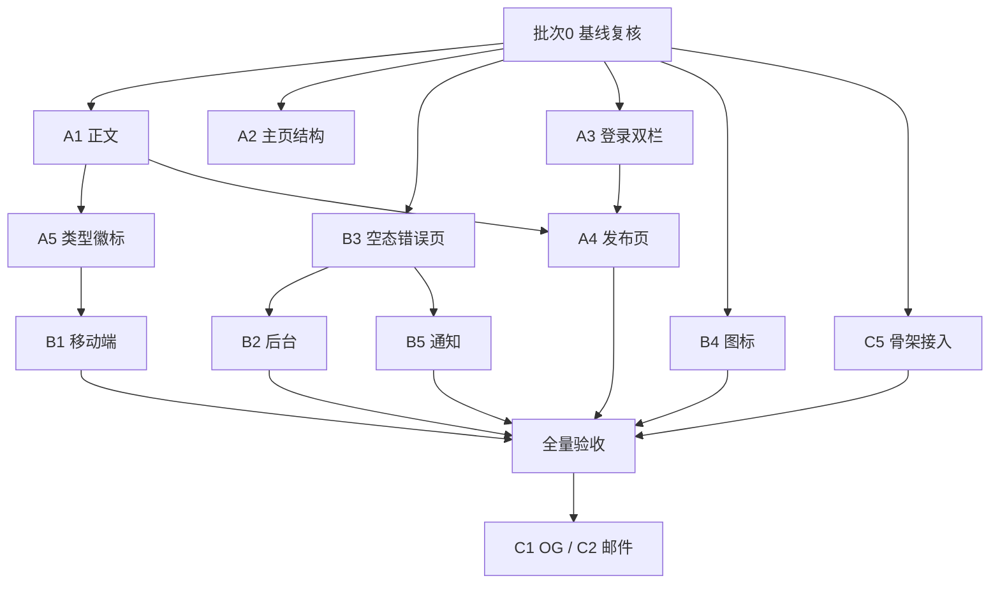

## 用户需求

把 `docs/design` 下 15 项设计（A1-A5、B1-B5、C1-C5）**全部**应用到真实前端页面，不做范围删减。此前只改了 CSS 数值、未做结构调整的部分（A2 主页、A3 登录、A4 编辑器、A5 类型徽标、B1 移动端、B2 批量条、B3 错误页、C5 接入）必须补齐。

## 产品概述

站点视觉从「能用」升级为「暖纸编辑风」：暖白纸底 + 墨绿主色 + 衬线标题 + 6px 圆角体系。覆盖阅读、发布、登录、个人主页、列表、后台、移动端、通知、空态、打印、图表、分享卡与邮件全链路，保证同一套 token、同一套字号阶、同一套圆角档。

## 核心功能

- 正文阅读：720 版心、15px/1.9、标题去下划线、图注与代码块容器
- 内容辨识：列表项左侧 3px 类型色条 + 标题前文字徽标（话题/动态/问答/文章）
- 个人主页：头图 16:5、头像 88px 骑压交界、统计条等分
- 登录：900 宽双栏，左品牌说明、右 420 表单
- 发布：760 版心，标题 25px 衬线，工具栏/正文/底部三带分离
- 移动端：分类条横向滚动、底部常驻导航、安全区适配、触控 ≥44
- 后台：筛选栏分层、表头吸顶、数字右对齐、批量操作条
- 通知：时间分组、未读标记、类型导航
- 空态与错误页：统一线稿 + 衬线标题 + 明确下一步动作
- 分享与邮件：OG 卡片 1200×630、邮件 600 宽 table 模板

## 技术栈

沿用现有栈，不引入新框架：React 19 + React Router v7（framework 模式）+ Tailwind v4 + shadcn/radix + lucide-react。后端 Go 1.26 + Gin + GORM（仅 C1/C2 涉及）。

## 实现策略

**1. 以文档为准，冲突按基线取整**

design.md 与 `UI设计规范.md` v2.0 存在数值冲突，统一按基线处理：

| 冲突 | design.md | 基线 | 取值 |
| --- | --- | --- | --- |
| 字号 | 10.5 / 11.5 / 12.5 / 13.5 / 14.5 | 9 档唯一 | 11 / 12 / 12 或 13 / 13 / 14 |
| 圆角 | 行内 code 3px、A5 色条 3px | 只允许 4/6/8/999 | 4 |
| 间距 | 引用 13/18、A4 元信息 14 | 4/8/12/16/24/32/48/64(+20) | 12/16、16 |


**2. 四层递进，层间可独立验收**

```
Token 层  web/styles/globals.css          颜色/字号/圆角/字体/断点变量
布局层  web/styles/common.css              容器/分栏/页面留白/响应式断点
组件层  web/styles/{content,user,auth,topic,editor,charts,print}.css + components/**
页面层  web/app/routes/** 与业务组件          组装与插槽
```

**3. 结构改造而非仅改数值**

A2/A3/A4/A5/B1/B2/B3 的缺口全部在**结构**，必须改 TSX：

- A2：`.profile` 由 `position:absolute + top:100px` 改为文档流 + `margin-top:-44px`，头图用 `aspect-ratio`
- A3：新增 `auth-shell` 容器组件承载左右栏，`signin-form` / `signup-form` 只负责右栏内部
- A4：`topic-create-form.tsx` 内 `simple-editor` 拆成工具栏 / 正文区 / 底部状态带三段
- A5：`topic-list-item.tsx` 与 `article-list.tsx` 的列表项统一注入 `data-content-type` 与徽标节点
- B1：新增 `components/layout/bottom-nav.tsx`，挂载在 `LayoutChrome`（已排除 `/dashboard` 与 `/install`）
- B2：`dashboard-data-table.tsx` 增复选框列 + 选中态；新增 `dashboard-bulk-bar.tsx`
- B3：`error-page.tsx` 重做为统一结构；`empty-state.tsx` 增 `action` / `secondaryAction` 插槽

**4. 全局 CSS 与 AGENTS.md 2.5.3 的冲突处置**

`docs/AGENTS.md` 规定「不新增全局 CSS 文件」，但落地设计 token 必须改 `globals.css`。处置口径：

- `globals.css`、`common.css`、`content.css` 等既有文件：直接改，属既定入口
- `style/motion.css`：**合并进 `common.css`**，不保留独立文件
- `style/charts.css`：保留。recharts 是第三方库，其内部 DOM 结构无法用 Tailwind 工具类选择，只能靠属性选择器覆盖
- `style/print.css`：保留。`@media print` 属介质例外（规范 4.10），与屏幕样式生命周期不同

上述保留项会在 `common.css` 顶部注释中写明理由，避免后来者误判。

**5. 按批次交付与验收**

每批产出后执行统一门禁，并逐条对照同名 `prototype.html` 人工核对：

```
cd web; corepack pnpm exec tsc --noEmit
cd web; corepack pnpm exec eslint <改动文件>
go build -tags dev ./internal/... ./cmd/    # 仅 C1/C2 涉及
```

环境已知限制：`pnpm typecheck` 与 `react-router build` 会因 safe-delete shim 拦截目录清理而失败，改用上面两条命令替代，并在汇报中标注。

## 架构设计

### 落地顺序与依赖



### 数据与状态

全部为展示层改动，**不涉及新增表、不新增接口、不改既有接口契约**。唯一读数据变化：

- A2 统计条第 4 项「获赞」：现有接口只返回关注/粉丝/帖子，**按 3 项等分实现**，不硬造第 4 项
- B2 批量删除：**前端多选 + 循环调既有单删接口**，不新增批量接口与权限点
- B5 未读标记：`UserMessage` 无 `read` 字段，**先用 `status` 近似**；若语义不成立则该项降级为「仅做类型导航 + 角标」

## 目录结构

```
web/
├── styles/
│   ├── globals.css          [MODIFY] 补 --slate；定义 --reading-width:720px；复核 21 个 token
│   ├── common.css           [MODIFY] 合并 motion.css 的 @keyframes 与 reduced-motion；顶部注释说明保留 charts/print 的理由
│   ├── content.css          [MODIFY] .bbs-content 加 max-width:720px；行内 code 13px；引用补 14px；列表项行高 1.8
│   ├── user.css             [MODIFY] A2 全套：头图 aspect-ratio/径向渐变、头像 88px 负边距、信息区 12/28/24、昵称 25、元信息 12、简介 13、统计条等分
│   ├── auth.css             [MODIFY] A3：900 外框、左栏渐变+padding40、右栏 420/36/32、分段切换、输入 40、主按钮全宽、第三方 38、<900 隐藏左栏
│   ├── topic.css            [MODIFY] A4 容器 760、标题 25 衬线仅底边线、chip 26；A5 色条 top/bottom 16、左内边距 24
│   ├── editor.css           [MODIFY] A4：编辑器容器 1px+radius6+hidden、工具栏 40/--bg-subtle/下边线/按钮 28、正文区 min-h260/padding18-20/15-1.9
│   ├── charts.css           [KEEP]   保留，recharts 第三方 DOM 无法用工具类覆盖
│   ├── print.css            [KEEP]   保留，@media print 属介质例外
│   └── motion.css           [DELETE] 内容并入 common.css
├── components/
│   ├── layout/
│   │   ├── layout-chrome.tsx        [MODIFY] 挂载 <BottomNav />
│   │   └── bottom-nav.tsx           [NEW]    56 高三项、中间 44 圆钮上凸 12、safe-area、仅 <860 显示
│   ├── common/
│   │   ├── empty-state.tsx          [MODIFY] 增 action / secondaryAction 插槽
│   │   ├── error-page.tsx           [MODIFY] 120 线稿 --line-strong 2px + 20 衬线 + 13 说明 + 主/次操作，404/500/403 居中
│   │   └── skeletons.tsx            [KEEP]   已建，接入列表页与详情页
│   ├── auth/
│   │   ├── auth-shell.tsx           [NEW]    900 双栏容器，左品牌说明栏 + 右插槽
│   │   ├── signin-form.tsx          [MODIFY] 只负责右栏内容，输入 40、主按钮全宽、第三方描边 38
│   │   └── signup-form.tsx          [MODIFY] 同上
│   ├── topic/
│   │   ├── topic-list-item.tsx      [MODIFY] 注入 data-content-type + 徽标节点；左内边距 24；<860 三列改两行
│   │   └── topic-create-form.tsx    [MODIFY] 拆工具栏/正文区/底部状态带；标题输入 25 衬线；底部草稿态+字数+预览/发布
│   ├── article/
│   │   └── article-list.tsx         [MODIFY] 列表项加「文章」徽标与 data-content-type
│   ├── user/
│   │   ├── user-profile-card.tsx    [MODIFY] 头图与头像改文档流结构
│   │   ├── profile-shell.tsx        [MODIFY] 信息区三带结构
│   │   └── user-lists.tsx           [MODIFY] B5 未读条 + 类型导航 + 角标 99+
│   └── dashboard/data/
│       ├── dashboard-data-table.tsx [MODIFY] 复选框列 40 + 选中高亮 + 操作列固定
│       ├── dashboard-data-toolbar.tsx [MODIFY] 筛选栏 48 高 + 底 1px + 控件 32/200/120
│       └── dashboard-bulk-bar.tsx   [NEW]    44 高 --brand-soft 底 + 已选 N 项 + 批量删除
├── app/routes/
│   ├── user.signin.tsx              [MODIFY] 用 AuthShell 包裹
│   └── user.signup.tsx              [MODIFY] 同上
└── lib/i18n/messages/
    ├── zh-CN.ts                     [MODIFY] 空态四套文案、类型徽标、草稿态、批量条
    └── en-US.ts                     [MODIFY] 同上英文
```

后端（仅最后一批）：

```
internal/handlers/api/og_handlers.go        [NEW]   GET /api/og/{type}/{id}.png，satori 渲染 + res/og 缓存
internal/server/router.go                   [MODIFY] 注册 OG 路由
internal/services/email_service.go          [MODIFY] 三封模板走新 HTML
res/og/                                     [NEW]   生成物目录（gitignore）
```

## 实现要点

- **性能**：A5 徽标与 data 属性均为静态节点，无额外请求；B1 底部导航用 `position:fixed` + `env()`，不触发重排；B4 图标全量替换只在构建期生效，不影响运行时
- **暗色**：所有新样式只用 token（`--brand`/`--card`/`--line`/`--cover-*`），不写死 hex，暗色自动适配；`--paper-grain` 在 `.dark` 下已为 `none`
- **不破坏既有**：`EmptyState` 新增插槽为可选 prop，向后兼容；`ErrorPage` 保持 `statusCode`/`message` 入参不变；`BottomNav` 只在 `LayoutChrome` 的非 dashboard 分支渲染
- **回滚**：按批次提交，每批可 `git checkout` 对应文件独立回退

## Agent Extensions

### SubAgent

- **code-explorer**
- Purpose: B4 图标尺寸统一需要全量扫描 `web/components/**` 与 `web/app/**` 下所有 lucide 图标的 `size` / `className` 尺寸写法，返回完整清单
- Expected outcome: 产出「文件路径 + 行号 + 当前尺寸 + 目标档位」的替换清单，覆盖全部非 14/16/20/24 的用法

- **code-explorer**
- Purpose: A2 个人主页改造前，确认 `user-profile-card.tsx`、`profile-shell.tsx`、`user-profile-client-page.tsx` 三者的渲染层级与 `profile-form.tsx` 编辑态复用关系
- Expected outcome: 给出安全改造点，确保头图与头像改文档流后不影响编辑态布局